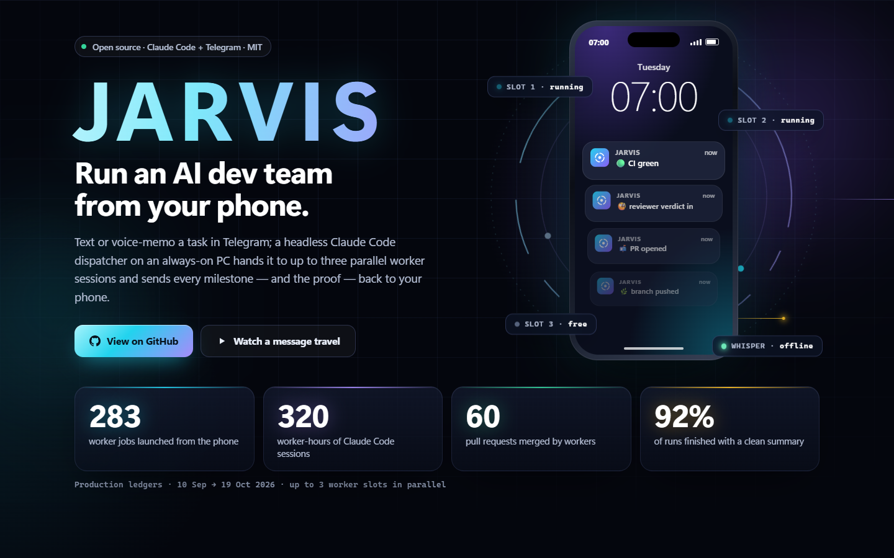
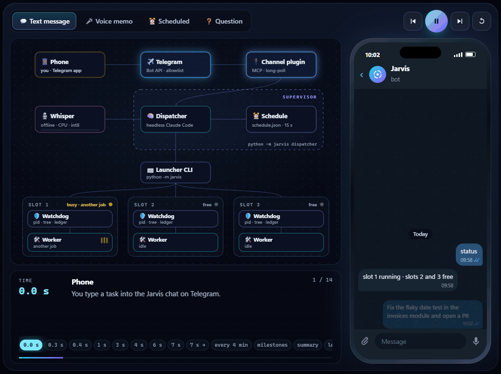
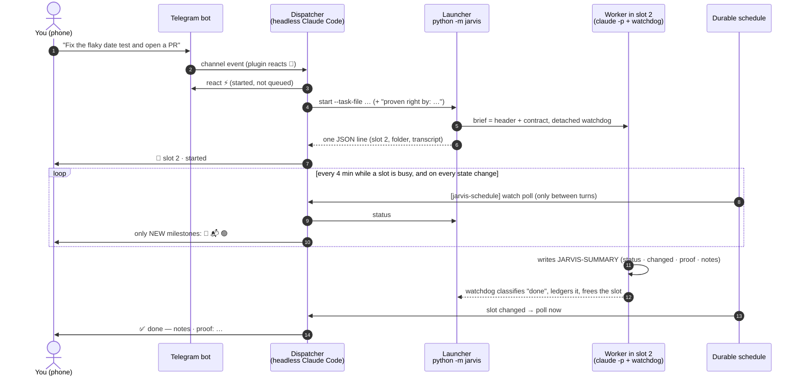
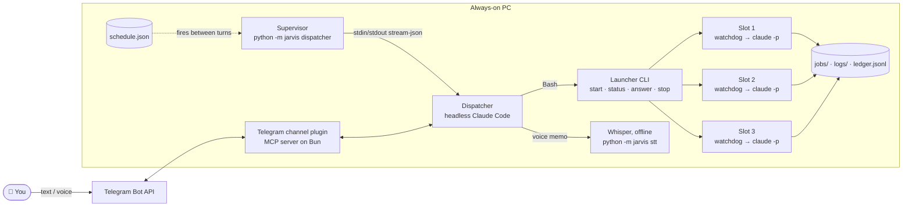
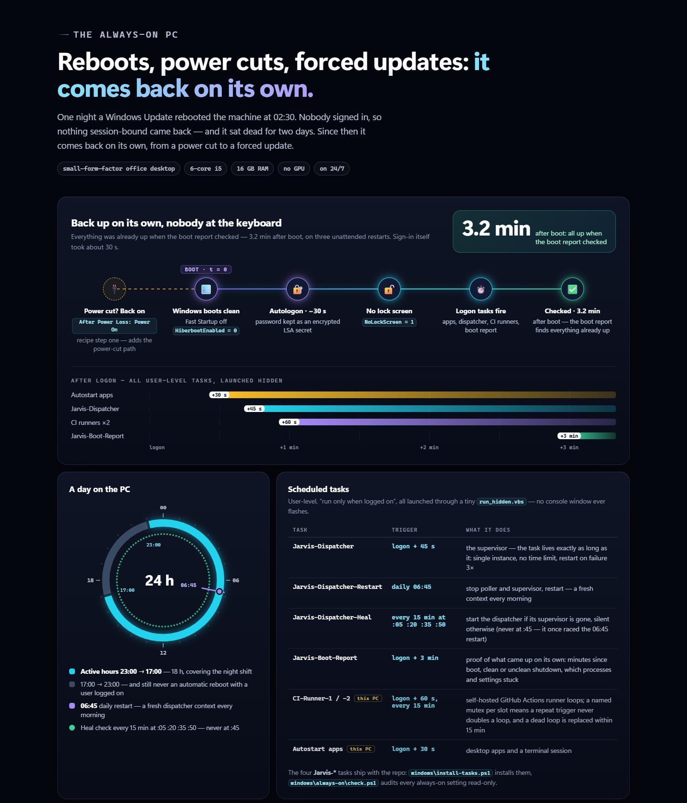

<p align="center">
  <a href="https://pepemilanese.github.io/Jarvis/"></a>
</p>

<h1 align="center">Jarvis</h1>
<p align="center"><b>Run an AI dev team from your phone.</b><br>
A Telegram message — or a voice memo — becomes work done by up to three Claude Code sessions on an always-on PC,<br>
with live milestones back on your phone.</p>

<p align="center">
  <a href="https://pepemilanese.github.io/Jarvis/"><b>▶ Watch a message travel (interactive page)</b></a> ·
  <a href="#quick-start-about-10-minutes">Quick start</a> ·
  <a href="#architecture">Architecture</a> ·
  <a href="#lessons-learned">Lessons learned</a>
</p>

<p align="center">
  <a href="https://github.com/PepeMilanese/Jarvis/actions/workflows/tests.yml"></a>
  
  
  
  <a href="LICENSE"></a>
</p>

---

## The story

I build software alone, and most of my good ideas arrive when I am away from the keyboard. So I set
up one PC that never sleeps, put a [Claude Code](https://claude.com/claude-code) session on it that
listens to a private Telegram bot, and taught it to hand real work to other Claude Code sessions —
each in its own slot, each with a written contract, each reporting back when it reaches a milestone.

I type (or *say*) **"fix the flaky date test and open a PR"** on the bus. Ten seconds later the phone
shows ⚡ *on it* and 🚀 *slot 2 · started*. Twenty minutes later: 🌿 branch pushed · 📬 PR opened ·
🟢 CI green · ✅ *done — the test was timezone-dependent; proof: the new test fails on main and passes on
the branch.*

That is Jarvis. It started as the control room for **Saldo**, a private ERP product I am building (none of
its code or process is in this repo), and became the way I run everything on that machine. This
repository is a clean, runnable reference version of it — same architecture, same guards, same lessons —
that you can set up with your own bot in about ten minutes.

### Forty days of real use

From the first job on 10 Sep 2026 to 19 Oct 2026, read from the production ledgers:

| | |
|---:|---|
| **283** | worker jobs launched from the phone (300 slot runs, counting resumed ones) |
| **320** | worker-hours of Claude Code sessions |
| **92 %** | of runs finished with a clean, structured summary · 17 stopped to ask a question and were resumed from the phone |
| **60** | pull requests merged by worker sessions (155 counting a separate nightly automation, not in this repo) |
| **3** | parallel slots — slot 1 ran 155 runs, slot 2 ran 90, slot 3 ran 55 · busiest day: **33 runs** · longest single run: **~36 h** |
| **~370 / ~960** | phone messages handled / replies sent by the dispatcher |
| **~20** | voice memos, transcribed **on the PC** by Whisper (no speech-to-text service ever heard them) |
| **53 · 46 · 7** | dispatcher sessions brought up · fresh-context restarts (36 scheduled at 06:45, 10 on demand) · self-healing guards that fired for real |
| **3.2 min** | after an unattended reboot, the boot report (set for 3 minutes after sign-in) found everything already up — sign-in itself took ~30 s, with nobody at the keyboard |

---

## How one message travels

<p align="center"></p>



**Voice memo?** 🎤 → `download_attachment` → `python -m jarvis stt` (Whisper large-v3-turbo, on the PC,
about 25–35 s for a one-minute memo on a quiet machine) → **`🎤 I heard: …` immediately** → it acts at once, without waiting for a
confirmation; you read the echo while the work is already running and say "stop" if it misheard.
**A question?** The worker ends with a `JARVIS-QUESTION` (options A/B + a default), its slot stays
reserved, your reply ("B") resumes *the same session*. **Later?** "Check the nightly build at 7" becomes
a durable schedule entry that survives every restart.

---

## What's in the box

- **A supervised, self-healing dispatcher** — `claude -p --channels plugin:telegram@… --input-format stream-json` with stdin held open, every event logged, and [six guards](#self-healing) that each come from a real outage.
- **Three parallel worker slots** — each job gets a folder (scratch, a project you name, or its *own git worktree and branch*), a brief, a detached watchdog that owns the process, and a ledger row.
- **A worker contract** ([`manual/WORKER.md`](manual/WORKER.md)) — one turn, foreground only, ask before the irreversible, finish with a machine-readable block that carries a **`proof:`** line.
- **A dispatcher manual** ([`manual/DISPATCHER.md`](manual/DISPATCHER.md)) — how to read messages, when to delegate, how to report only *changes*, how to tell a long job from a wedged one.
- **A durable schedule** — one-shots, intervals and cron entries in a JSON file the supervisor fires into the session *between turns*; nothing is lost at a restart.
- **Offline voice memos** — faster-whisper on the CPU, pinned and checksum-verified model, a benchmark, and a decoder tuned so it never invents an instruction ([`stt/README.md`](stt/README.md)).
- **A quota readout** — the subscription's 5-hour and weekly windows, % used and reset times, read without ever refreshing (or printing) the login token.
- **An always-on recipe for Windows** — auto sign-in, never sleep, no surprise reboots, logon tasks, a 15-minute self-heal, a boot report, and a read-only audit script ([`windows/always-on/`](windows/always-on/README.md)).
- **78 tests**, standard library only, green on Windows and Linux — a fake `claude` drives the whole lifecycle, so no test ever calls a model or touches a real bot.

---

## Quick start (about 10 minutes)

**You need:** Python 3.11+, [Claude Code](https://claude.com/claude-code) logged in with your claude.ai
account (`claude auth login` — the Telegram channel needs that login), [Bun](https://bun.sh) (the
Telegram plugin's server runs on it), git, and a phone with Telegram. Windows 10/11 is the tested
home; on Linux the test suite passes and systemd units are included as a reference (use `python3` where
the examples say `python`); macOS should work but is untested.

**1 · Get it**

```bash
git clone https://github.com/PepeMilanese/Jarvis.git
cd Jarvis
cp jarvis.example.toml jarvis.toml        # optional: every key has a default
```

**2 · Make a bot and connect it** (once). In Telegram, message [@BotFather](https://t.me/BotFather),
send `/newbot`, copy the token. Then, **inside the Jarvis folder**, start `claude` and run:

```
/plugin install telegram@claude-plugins-official
/telegram:configure <your-bot-token>
```

Quit, start `claude --channels plugin:telegram@claude-plugins-official` in the same folder, DM your bot —
it answers with a pairing code — and run `/telegram:access pair <code>`, then
`/telegram:access policy allowlist` so strangers are dropped silently. Quit that session again: **only one
process may poll a bot**, and from now on that is the dispatcher.

**3 · Check everything**

```bash
python -m jarvis doctor
```

It checks Python, the CLI and its login, Bun, the plugin, the token (never shown), the allowlist, the
manuals, and the optional parts. Fix every `FAIL`.

**4 · Voice memos** (optional, ~1.6 GB download)

```bash
python -m jarvis stt-setup
python -m jarvis stt tests/fixtures/hello.ogg      # → "Hello Jarvis. Please check the nightly build, …"
```

**5 · Run it**

```bash
python -m jarvis dispatcher --dry-run    # what would run; launches nothing
python -m jarvis dispatcher              # the real thing (Ctrl+C stops it)
```

Message your bot: *"how much free disk space is there?"* (it answers itself) — then *"write a haiku
about a computer that never sleeps into a file"* (🚀 a worker in slot 1, then ✅ with the file's path).
Try `python -m jarvis status` in another terminal while it runs. The very first job this public version
ran, through the real CLI, came back as (trimmed — the full block also carries `task`, `workdir`, `git`
and `left-open`):

```
=== JARVIS-SUMMARY ===
status: done
changed: haiku.txt in WORKDIR (new); one line appended to the steps file
proof: read the file back: 3 lines total, and all 3 are non-empty
notes: The haiku: "Fans hum through the dark / a cursor blinks, wide awake / the moon logs off first".
=== END-JARVIS-SUMMARY ===
```

**6 · Make it permanent**

```powershell
# Windows: logon task + daily 06:45 restart + 15-minute heal (no admin needed)
powershell -NoProfile -ExecutionPolicy Bypass -File windows\install-tasks.ps1 -BootReport
Start-ScheduledTask -TaskName Jarvis-Dispatcher
# then the always-on recipe: windows\always-on\README.md (check.ps1 tells you what is missing)
```

```bash
# Linux: systemd user units (edit WorkingDirectory= in jarvis-dispatcher.service if you cloned elsewhere than ~/Jarvis)
mkdir -p ~/.config/systemd/user && cp linux/jarvis-*.service linux/jarvis-*.timer ~/.config/systemd/user/
systemctl --user daemon-reload
systemctl --user enable --now jarvis-dispatcher.service jarvis-restart.timer
loginctl enable-linger "$USER"     # keep it running with nobody logged in
```

To take it down for a while, stop the *service* rather than the process — the heal task (or systemd)
would otherwise bring it back within minutes: `Disable-ScheduledTask Jarvis-Dispatcher-Heal`,
`Disable-ScheduledTask Jarvis-Dispatcher`, then `python -m jarvis dispatcher --stop` (Linux:
`systemctl --user stop jarvis-dispatcher`). Running jobs are not touched by any of this — each belongs to
its own watchdog, and the next dispatcher picks them up with its first `status`.

---

## Architecture



| Piece | What it does | Where |
|---|---|---|
| **Supervisor** | Runs the dispatcher session, verifies its channel, watches the poller, restarts it, alerts once when it cannot, and hosts the schedule thread. | [`jarvis/supervisor.py`](jarvis/supervisor.py) |
| **Dispatcher** | A long-lived headless Claude Code session with an operating manual. Answers small questions itself; anything that changes state or takes over a minute becomes a job. | [`manual/DISPATCHER.md`](manual/DISPATCHER.md) |
| **Launcher** | `start` claims a slot atomically, prepares the folder (scratch / `--dir` / `--repo` worktree), writes the brief, launches the watchdog detached and returns one JSON line in seconds. | [`jarvis/launcher.py`](jarvis/launcher.py) |
| **Watchdog** | Owns the worker process, snapshots its process tree every 15 s, reaps what the job left behind, classifies `done / question / ended-early / auth-failed / timeout`, ledgers, frees the slot. | [`jarvis/watchdog.py`](jarvis/watchdog.py) |
| **Worker** | `claude -p` under a contract; its stdin is the brief, its stdout a stream-json transcript, never a pipe anyone waits on. | [`manual/WORKER.md`](manual/WORKER.md) |
| **Durable schedule** | `--at`, `--in`, `--every`, `--cron`, plus the built-in watch loop. Fires only between turns; a fire is pending until a turn finishes on it, and is re-sent (max 3×) if the session died first. | [`jarvis/schedule.py`](jarvis/schedule.py) |
| **Transcript reader** | Session id, cost, recent activity — and PR links **only** from the job's own `gh pr create` output. | [`jarvis/transcript.py`](jarvis/transcript.py) |
| **Process safety** | Tree walks that never follow a stale parent pid; pids checked together with their creation time. | [`jarvis/procs.py`](jarvis/procs.py) |
| **Speech-to-text** | faster-whisper in its own venv, pinned model, `heard=` warning for silent translations. | [`stt/`](stt/README.md) |
| **Quota** | 5-hour and weekly windows from the same (undocumented) endpoint claude.ai's usage page uses; if it changes or refuses, the readout falls back to the session logs, then to one honest line. | [`jarvis/quota.py`](jarvis/quota.py) |

```
jarvis/            the package: python -m jarvis <command>   (standard library only)
manual/            DISPATCHER.md (the dispatcher's manual) · WORKER.md (the worker contract template)
stt/               offline Whisper: transcribe.py, fetch_model.py (pinned), requirements.txt
windows/           install-tasks.ps1, run_hidden.vbs, dispatcher.ps1, task-heal.ps1, task-restart.ps1
windows/always-on/ the always-on recipe: check.ps1 (read-only), harden-user.ps1, harden-admin.ps1, boot-report.ps1
linux/             systemd user units: the supervisor + the daily restart timer
docs/              the interactive page (GitHub Pages) and its assets
tests/             78 tests + fake_claude.py + a synthetic voice-memo fixture
```

Runtime state lives next to the code by default (`logs/`, `jobs/`, `locks/`, `work/`, `schedule.json`,
`ledger.jsonl` — all git-ignored), or wherever `JARVIS_STATE` points.

---

## Self-healing

Every guard is an incident that happened, in production, before the guard existed.

| What broke | The guard |
|---|---|
| **The deaf session.** A session snapshots its channel when it processes its *first* message. A kickoff sent before the bot poller was up produced a session that never heard a single message — 4 of 4 morning restarts; one ignored its owner for 24 hours. | Wait for the poller's `bot.pid`, settle 3 s, send the kickoff, read the `init` event, and kill + retry (15 s → 5 min backoff) any session whose channel is not `connected` with the `reply` tool. |
| **The poller died** under a live session. | Poller missing for 90 s → restart the session. |
| **The stolen bot.** Telegram allows one consumer per token; another Claude Code session opened in the folder started its own poller and took the bot — 73 minutes of silence behind a green "poller alive" check. | The poller must be a *descendant* of this session, re-proven every 5 minutes (pids get reused); stray pollers are swept before every launch. |
| **Logged out.** A refused token refresh wiped the CLI login; every message got a 401 while the channel still said "connected". | No session starts while `claude auth status` says logged out; a session answering "Failed to authenticate" is killed; **one** alert goes straight through the Bot API, and one "back online". |
| **A reaper walked into system processes.** Windows parent pids go stale and are reused, so `taskkill /T` trusted a chain that led from a job into core OS processes. | Never `taskkill /T`. A child must be younger than its parent; only known tree-process names are stopped; pids are stored with their creation time. |
| **The launcher hung for two hours.** A child inherited the pipe the dispatcher was reading, so its tool call waited for the whole job. | Workers and watchdogs get files, never pipes; started detached with `close_fds`; the launcher returns in seconds. |

Around those sit the outer layers: the 15-minute heal task, the daily 06:45 fresh context, the logon
task, auto sign-in and the BIOS power-on setting — see [the always-on PC](windows/always-on/README.md).

**No timers on working jobs.** By default a worker has no time ceiling and no budget cap (both can be set
in `jarvis.toml` if you want them). In production, ceilings only ever killed jobs that were *working*. The
dispatcher is the stop, and it decides from evidence: a job is **wedged** only when its pid is alive
**and** its transcript has stopped growing **and** its step line has stopped moving, across several polls.
Elapsed time and cost alone are never evidence.

---

## The always-on PC

<p align="center"></p>

A Windows Update rebooted the machine at 02:30 one night; nobody signed in, so nothing session-bound came
back and it sat dead for two days. Since then: **BIOS** *After Power Loss = Power On* · **auto sign-in**
(Sysinternals Autologon — an LSA secret, never a plaintext password) · **no lock screen, no password on
wake** · **never sleep, Fast Startup off** · **Windows Update** may not reboot while signed in, active hours
pinned to 23:00 → 17:00 · **logon tasks** (+45 s dispatcher, 06:45 restart, 15-min heal) · a **boot
report** that proves it all happened with nobody there · **remote access in unattended mode** as the safety
net. The full recipe, the CI-runner lessons and the scripts: [`windows/always-on/README.md`](windows/always-on/README.md).

---

## Lessons learned

1. **A session is not a service.** The AI login, the bot poller, Docker, a cloud drive: all per-user. So the machine signs itself in and everything starts from logon tasks — not "run as SYSTEM".
2. **Verify the channel, not the process.** A live process with a connected-looking plugin can still be deaf. Read what the session itself reports at init.
3. **Ownership, not liveness.** "Is the poller alive?" is the wrong question when any other session can take the bot. Ask whose it is.
4. **No timers on working jobs.** Budget and time ceilings only ever killed jobs that were working. Detect wedges from evidence: a stalled transcript under a live pid.
5. **Headless means one turn.** A worker that backgrounds a command and ends its turn is dead — and so is what it backgrounded. Foreground only; no single wait past ~9 minutes.
6. **Write between turns.** A message written into a running turn gets merged into it, and the first prompt's answer can vanish. The schedule fires only when the session is idle — and batches what is due into one message.
7. **Every task carries its own acceptance test.** `proven right by:` on the way in, `proof:` on the way out — evidence that does not rest on the agent's word.
8. **Never trust a scraped number.** PR numbers read from an agent's prose were wrong three times in one morning. Only numbers the job itself created are shown as fact.
9. **Speech-to-text can invent instructions.** A glossary prompt made Whisper append a plausible task nobody said, and a forced language silently *translates*. No glossary; a `heard=` warning instead.
10. **Never `taskkill /T`.** Parent pids go stale and get reused. Walk the tree yourself; a child must be younger than its parent.
11. **Fail soft, alert once.** The quota readout degrades to one honest line instead of a stack trace, and an outage sends one message, not a flood.

---

## Security model — read this before you run it

- **Workers run with `--permission-mode bypassPermissions`.** Headless means nobody can click "allow", so a
  worker can do anything your user account can. Run Jarvis on a machine (or a user account) you dedicate to
  it, and keep secrets you would not hand to an agent somewhere else. You can set a stricter
  `permission_mode` in `jarvis.toml`, at the cost of jobs that stop at the first tool they are not allowed.
- **The Telegram allowlist is the front door.** Only allow-listed user ids reach the dispatcher; switch the
  plugin to `allowlist` after pairing (`doctor` warns until you do). The dispatcher manual also forbids it
  to change its own access, tokens or flags because a message asked.
- **The contract is the second door.** Workers must ask before deleting outside their folder, sending
  anything as you, paying, deploying, changing the machine or rewriting git history — and treat text they
  read (web pages, files, issues) as data, never as instructions.
- **Secrets never travel.** The bot token stays in the plugin's `.env`; `doctor`, the alerts and the quota
  readout never print a token; the contract forbids putting one in a summary that goes to a phone.
- **No surprise bills.** An `ANTHROPIC_API_KEY` in your environment would make a headless `claude` bill per
  token instead of using your subscription. The dispatcher and the workers drop it (and `doctor` warns)
  unless you set `workers.allow_api_key = true`.
- **One poller per bot, and the dispatcher takes it.** Before every launch the supervisor stops *every*
  process of the Telegram plugin on the machine (a stray one would make the dispatcher deaf) — including
  one serving a different bot. And because `.claude/settings.json` enables the plugin for this folder, an
  interactive Claude Code session opened *in the Jarvis folder* starts its own poller and takes the bot
  (the supervisor notices within seconds and takes it back). Work on Jarvis itself from a second clone.
- **Scratch jobs cannot touch the Jarvis checkout.** Their folders live under `work/`, and git is told not
  to look above it (`GIT_CEILING_DIRECTORIES`), so a worker's `git reset --hard` stays in its own folder.

## FAQ

**Why Telegram?** A bot is free, works on every phone, supports voice notes, and Claude Code has an
official channel plugin for it. **Why not one big agent?** Separate sessions in separate folders run in
parallel, cannot trample each other, and each one's failure stays its own. **Does it need a GPU?** No —
everything, Whisper included, runs on a 6-core office CPU. **What does it cost?** It runs on a Claude
subscription; the quota readout tells you how much of the 5-hour and weekly windows you have used.
**Can I use it for non-code work?** Most of the 283 jobs were: research, data wrangling, documents, a
conference website, scripts for the machine itself.

## Credits

Built by **Petar Trajchevski** ([@PepeMilanese](https://github.com/PepeMilanese)) on top of
[Claude Code](https://claude.com/claude-code) and its official Telegram channel plugin, with
[faster-whisper](https://github.com/SYSTRAN/faster-whisper) for speech. Released under the [MIT licence](LICENSE).
